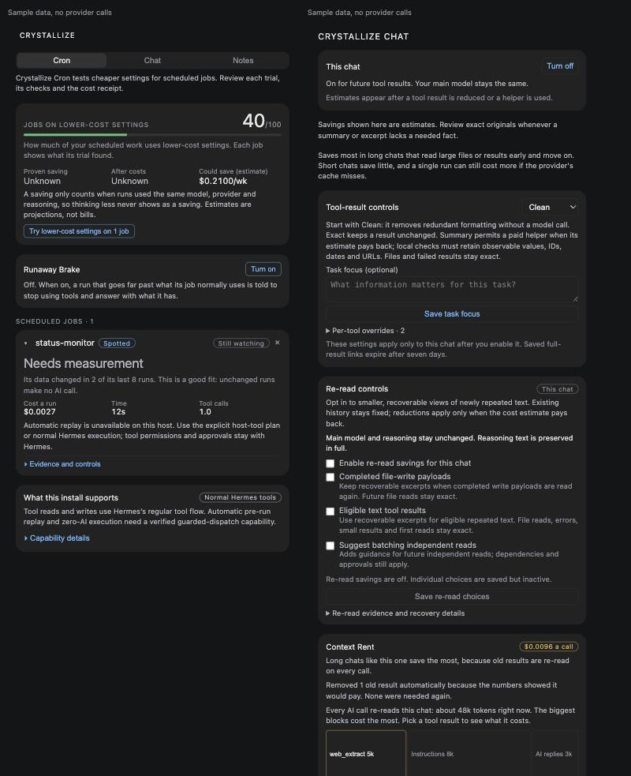
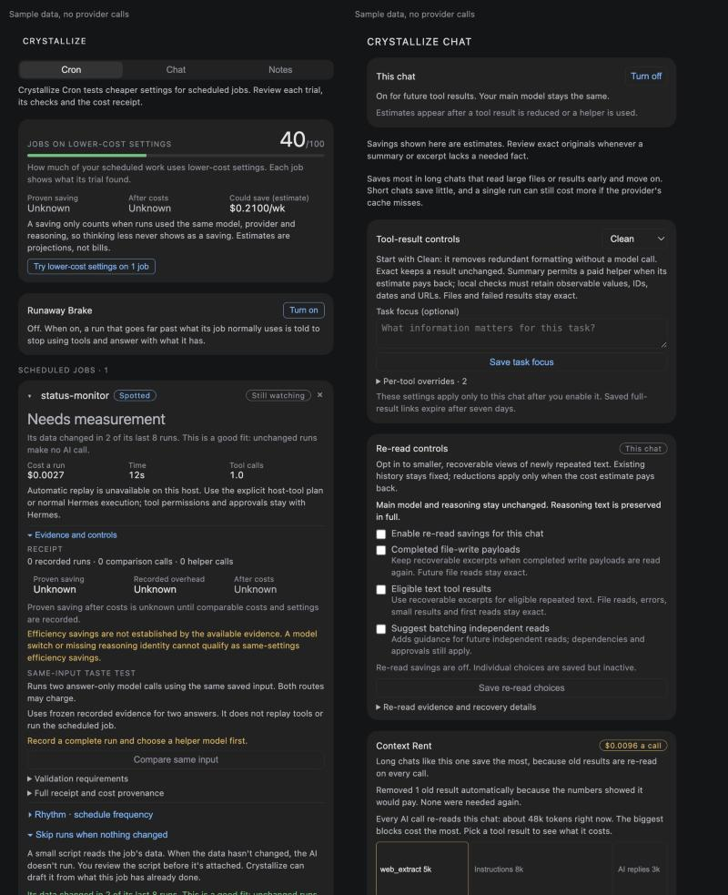

<!-- Draft body for the NousResearch/hermes-agent catalog PR. Not opened yet. -->
<!-- Title: plugin-catalog: add crystallize -->

Adds `plugin-catalog/crystallize.yaml` for [Crystallize](https://github.com/itsflownium/hermes-crystallize), pinned at `9571c8a5d6915a33aad86b2684625987344ab40a` (version `0.6.0`, `requires_hermes: ">=0.22.7"`, also declared in `plugin.yaml`). I'm the repository's owner (`itsflownium`).

## What it does

Crystallize lowers the cost of repeated work in Hermes chats and cron jobs. It does not change the model or reasoning effort the user picked.

- **Cron:** it drafts a small snapshot script from what a job already read. Once the user reviews and attaches the script, the job's AI run only happens when that data changes (Hermes monitor mode). Runaway Brake stops a run that goes far past the job's own normal use. Trials of lower-cost settings stay only if their checks pass and they cost clearly less; otherwise the old settings come back.
- **Chat:** Context Rent shows what each old tool result costs on every call and can remove it (the AI can still read the original back). Clean losslessly compacts tool output. Each chat and job gets local receipts.

Measured live at unchanged model, provider and reasoning, priced at public list prices (estimates, not billing), small samples: working chats cost 20–33% less on `tencent/hy3`, 13% less on `stepfun/step-3.7-flash` and 5% less on `deepseek/deepseek-v4.1-flash`, all on Nous Portal. Codex chats saved 13–19%. A cron job whose data changed once in 4 checks cost 60% less. Jobs whose data changes on every run gain nothing, and a chat that reads a removed result back can end slightly negative. The panel shows both cases. There's a recorded demo at `assets/demo/crystallize-demo.mp4`, with the raw pair reports in `docs/evidence/`.

## Hermes surfaces used

- Tools: `crystal_cheap`, `crystal_full_result`, `crystal_list`, `crystal_run`
- Hooks: `on_session_end`, `post_api_request`, `post_tool_call`, `pre_llm_call`, `pre_tool_call`, `transform_llm_output`, `transform_tool_result`
- Middleware: `llm_request`, `tool_execution`
- Also: `ctx.llm` for the optional helper calls, the `hermes crystal` CLI command, a Desktop panel (`desktop/plugin.js`, plugin SDK only) and a dashboard API.
- No `requires_env`, no Python dependencies, no OAuth.

## Disclosures (rule 13)

- **Reads outside its own data:**
  - Hermes session history and costs in `state.db`.
  - Cron outcomes in `cron/executions.db` and job definitions in `cron/jobs.json`.
  - Public config, route config and the user's own rate cards.
  - All of these use the current profile.
- **Network:**
  - **Price lookup:** once a day, public model prices from the active route's `/models` endpoint and `https://models.dev/api.json`, with no credentials or chat data. Turn it off with `hermes crystal prices --lookup off`.
  - **Paid calls:** the optional helper, compare and check features make paid model calls through the user's own Hermes route via `ctx.llm`. These are off by default, and hand-offs are labelled as costing more in live tests.
- **Shell and child processes:** cron tuning, promote and undo run `hermes cron` CLI children, which edit only the fields the user chose on the selected job. No approval is bypassed, and nothing inherits YOLO mode.
- **Files written outside plugin data:** approved snapshot scripts are copied under `scripts/crystallize-native/` after the user reviews the full source. They run with ordinary cron permissions.
- **Local data:** captured tool arguments and results (originals kept for recovery), cache entries, receipts and usage diagnostics, all in its plugin-data folder.
- **Background work:** helper calls use bounded background workers, and late usage is still counted.
- **Not done:**
  - No telemetry.
  - No reads of credential stores, `.env` or `auth.json`.
  - No token handling.
  - No self-update.
  - No runtime overrides of Hermes core.
  - No compiled payloads.

## Validation

`hermes plugins validate <clean clone at 9571c8a> --install-deps` was run with this branch's Hermes (`NousResearch/hermes-agent@3131ac3`):

```
✓ manifest  ✓ manifest fields  ✓ requires_hermes  ✓ config schema  ✓ requires_env  ✓ oauth
✓ loadable (__init__.py, desktop/plugin.js)  ✓ python dependencies — none declared
✓ capability probe  ✓ declared tools  ✓ declared hooks  ✓ declared middleware
✓ built-in tool collisions  ✓ security scan — safe  ✓ no core override  ✓ desktop surface
Validation passed.   (no warnings)
```

`scripts/validate_plugin_catalog.py plugin-catalog/` passes, and the catalog test files pass locally.

## Screenshots

The images are the real Desktop panel rendered with sample figures (labelled as such in the repo):




## Known limits (also in `known_issues`)

- Savings are list-price estimates on small samples, tested on Nous and Codex only.
- Automatic replay of learned tool plans isn't available on the public SDK. See `docs/sdk-gaps.md`, which lists the hooks that would help.
- Under `plugins.isolation: host`, the `hermes crystal` CLI subcommands aren't wired, but the panel and tools still work.
